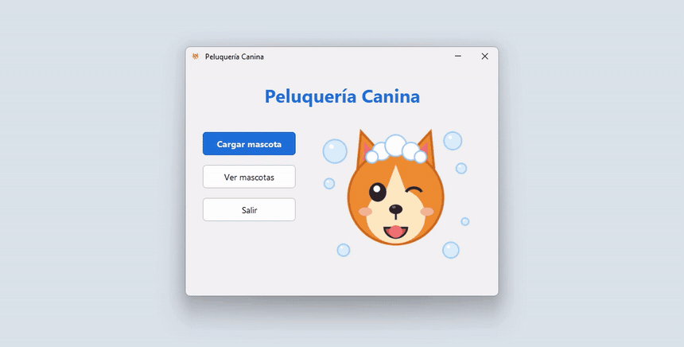

# Peluquería Canina

App de escritorio en Java para registrar las mascotas que atiende una peluquería canina y los datos de sus dueños, con alta, listado, edición y baja sobre una base MySQL. La hice sola en marzo de 2026 como ejercicio integrador del curso de Programación Orientada a Objetos de TodoCode Academy.

## Problema que resuelve

La peluquería necesita registrar a sus clientes (mascota y dueño) y que esos datos queden guardados para consultarlos más adelante. El desafío técnico era armarlo con el modelo de capas: la interfaz no sabe cómo se guardan los datos, y la persistencia la resuelve JPA mapeando `Mascota` y `Dueno` a tablas.

## Demo



Los datos del GIF son inventados.

## Tecnologías

- Java 21
- Swing con FlatLaf
- JPA con EclipseLink
- MySQL
- Maven

## Cómo funciona

El código está dividido en tres paquetes: `igu` (ventanas), `logica` (entidades y una `Controladora` que valida antes de guardar) y `persistencia` (acceso a la base con JPA). La interfaz solo habla con la `Controladora` y no importa nada de JPA.

La primera versión la hice siguiendo los videos del curso, con el editor visual de NetBeans. Después la revisé para el portfolio. Las decisiones que tomé y por qué:

- **El dueño se guarda en cascada con la mascota.** Se carga en el mismo formulario, así que no tiene sentido que exista por separado. Antes, al borrar una mascota, el dueño quedaba huérfano en la base.
- **Un solo formulario para alta y edición.** Las dos pantallas eran casi copias, y en la de edición había un bug de copiar y pegar: Atención especial se precargaba con el valor de Alérgico.
- **Una sola `EntityManagerFactory`** compartida por toda la app, en lugar de una por ventana.

## Cómo correrlo

Necesitás Java 21, Maven y MySQL en `localhost:3306` con el usuario `root` sin contraseña (la configuración por defecto de XAMPP). La base y las tablas se crean solas.

```bash
git clone https://github.com/solalcaraz/peluqueria-canina.git
cd peluqueria-canina
mvn compile exec:java
```

## Qué aprendí y qué mejoraría

**Qué aprendí**

A separar una aplicación en capas y a mapear clases a tablas con JPA, incluida una relación uno a uno con cascada.

**Qué mejoraría**

- Guardar Alérgico y Atención especial como booleanos en lugar de los textos "Si" y "No".
- Permitir que un dueño tenga varias mascotas.
- Sumar tests automatizados.
